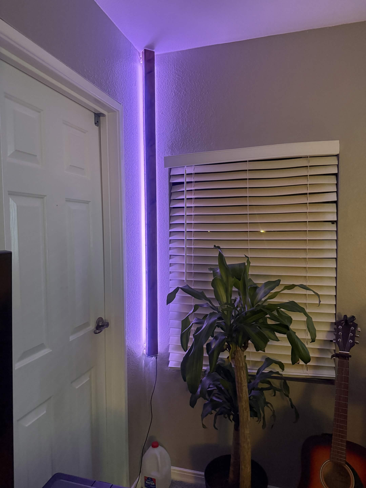
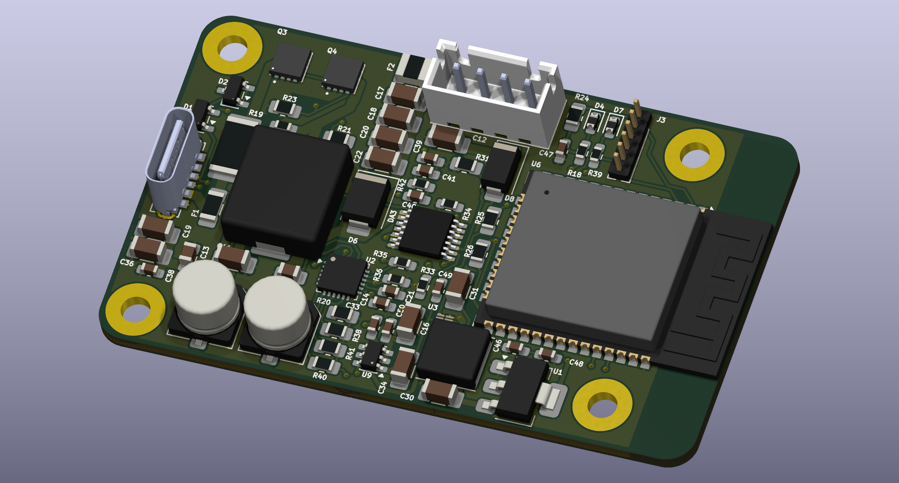
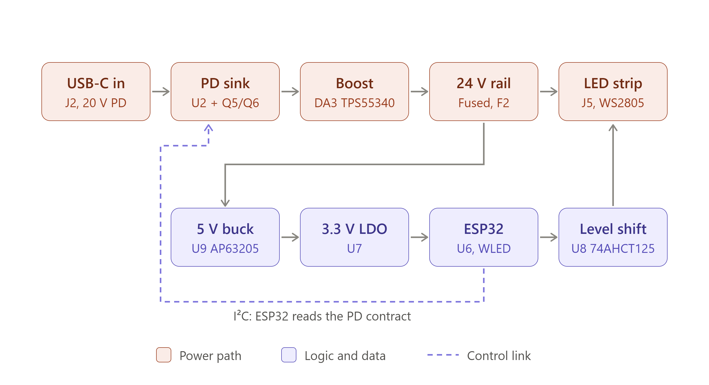
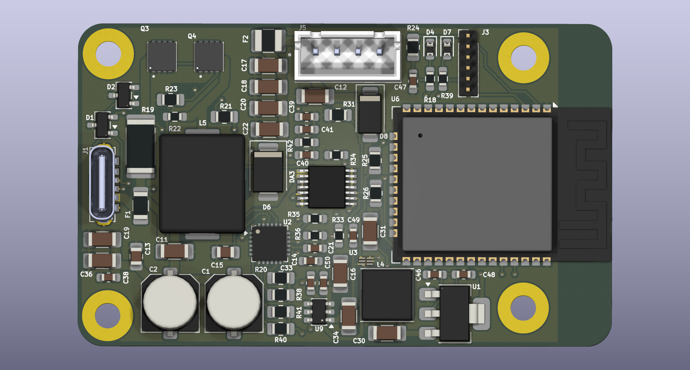

# Carom — USB-C Powered 24 V Addressable LED Controller

A custom controller PCB for a wall-bounce LED fixture: an addressable LED strip mounted on a wooden
body, aimed at the wall so the light reflects softly into the room. The board takes power from an
ordinary USB-C laptop charger, boosts it to 24 V for the strip, and runs [WLED](https://kno.wled.ge/)
on an ESP32 for Wi-Fi control of colour, tunable white, and effects.

Project files have been removed from this repo to prevent direct copying of the design, although reverse engineering is still possible.

  
  &nbsp;

  

**At a glance**

| | |
|---|---|
| Input | USB-C Power Delivery, negotiates 20 V (65 W charger) |
| Output | 24 V regulated rail for the strip, 2 A / 48 W design point |
| LEDs | WS2805 24 V strip (RGB + warm/cool white per pixel) |
| Controller | ESP32 running WLED (Wi-Fi, app/web control) |
| PCB | 62.9 × 38.1 mm, 2-layer, 1.6 mm, designed in KiCad for JLCPCB assembly |
| Enclosure | Wooden fixture body plus 3D-printed PCB mount and wall brackets |

---

## The problem

The first version of this fixture used an off-the-shelf setup: a 5 V / 3 A wall adapter, an ESP32
dev board, and 100 WS2812 LEDs along 1.7 m. It had two faults: it wasn't bright enough, and it
browned out (reset) at higher brightness.

The root cause was the 5 V architecture. 100 WS2812 LEDs at full white need about **6 A at 5 V**, which most off the shelf supplies I bought died after about 2 years. On top of that, pushing several amps down 1.7 m of thin strip copper
causes a large voltage drop, so the far end dims and colour-shifts.

## The approach: move to 24 V

Power is voltage × current, so the same light at 24 V needs about **one fifth of the current**.
That fixes both faults at once: the supply load is reasonable, and a 1 V drop along the strip is
4% of the rail instead of 20%. No power injection wires are needed.

The rest of the design followed from that decision and a few user requirements: tunable white *and*
colour, no bulky inline power brick, and no unneeded features.

  

### Power path

1. **USB-C PD input.** A dedicated USB Power Delivery sink controller negotiates 20 V from a standard
   laptop charger, then turns on a back-to-back MOSFET load switch so nothing downstream sees power
   until the contract is agreed. The input is fused and has a current-sense shunt.
2. **20 V → 24 V boost.** A TI TPS55340 boost converter (integrated 5 A switch) lifts the PD rail
   to 24.2 V. An enable divider holds the boost off below ~14 V, so it can't try to start from the
   5 V USB default before PD negotiation completes.
3. **Protected 24 V output.** The strip output has its own fuse and a TVS diode for transient
   protection.
4. **Logic rails.** A synchronous buck steps 24 V down to 5 V efficiently, then a low-noise LDO
   makes a clean 3.3 V for the ESP32's radio. (Dropping 24 V straight to 3.3 V with an LDO would
   waste ~2 W as heat.)

### Control path

- **ESP32 + WLED.** Classic dual-core ESP32, chosen because it is WLED's officially supported
  target. WLED provides the phone/web UI, effects, presets, and over-the-air updates.
- **Level shifting.** The ESP32 outputs 3.3 V logic, but the WS2805's data input threshold is
  about 3.5 V. A 74AHCT125 buffer translates the data line to 5 V with a series resistor at the
  connector. Driving 3.3 V directly "works on short wires" and then flickers in the field.
- **PD-aware brightness (design intent).** An I²C link lets the ESP32 read the negotiated PD
  contract, so a weaker charger can dim the strip gracefully rather than reset the board.

### Why WS2805

The WS2805 drives five channels per pixel (red, green, blue, warm white, cool white), so one strip
can do both saturated colour and good-quality tunable white. It also has a backup data line: if
one pixel IC fails, the rest of the strip keeps working.

---

## Engineering highlights

**Boost converter design, verified against the datasheet.** Every pin and component value of the
boost stage was checked against the TI datasheet:

| Parameter | Value | Note |
|---|---|---|
| Switching frequency | 500 kHz | Deliberate; lower frequencies risk not recovering from current-limit foldback |
| Output | 24.21 V | Set by feedback divider |
| Duty cycle | 19.1% | 20 V in → 24 V out |
| Peak switch current | 2.96 A | vs 5.25 A minimum current limit (~44% headroom) |
| Soft-start | 30 ms | Limits inrush from the charger |
| Phase margin | ≥ 65° | After compensation retune |

**Compensation retune instead of more capacitors.** Ceramic capacitors lose much of their rated
capacitance under DC bias (a 10 µF part at 24 V may act like a fraction of that). Rather than
buying a larger output bank, the loop compensation (R/C on the COMP pin) was retuned so the loop
stays stable across the full range of real-world capacitance. A zero-cost fix on the same
footprints.

**Careful capacitor placement.** Bulk electrolytics sit on the 20 V intermediate rail as input
filter damping, not on the 24 V output (where their ESR hurts stability) and not on USB VBUS (which
the USB-C spec limits to 10 µF).

**Measured, not assumed.** Before committing to a board, the strip was bench-tested on a lab
supply: **24.0 V × 0.900 A = 21.6 W** at full brightness on all channels, about 84% of the
datasheet figure, which is typical. Those measurements set the WLED current limiter and the
charger requirement:

| Case | 24 V rail | At charger (20 V) | Load on 65 W charger |
|---|---|---|---|
| Expected (higher-density strip) | 1.33 A / 32 W | 1.72 A / 34 W | 53% |
| Datasheet worst case | 1.57 A / 38 W | 2.03 A / 41 W | 63% |
| Rail design point | 2.0 A / 48 W | 2.58 A / 52 W | 79% |

The board is sized so the strip can be upgraded from 60 LED/m to 84 LED/m (~44% more light)
without hardware changes, and it runs from an ordinary 3 A USB-C cable (no special 5 A e-marked
cable needed).

**Design for manufacture.** The BOM was reviewed against distributor stock for a
miniaturization pass (smaller passives and modules where cost and availability allowed). The layout
follows switching-regulator practice: the tightest possible boost output loop, a thermal via array
under the converter, feedback traces routed away from the switch node, a continuous ground plane,
and a copper-free keepout under the ESP32 antenna, which overhangs the board edge.

---

## PCB

  

Left to right, the layout follows the power flow: USB-C input and PD controller, then the boost
inductor, diode and output capacitors, then the strip connector and 24 V protection, with the
logic supply and ESP32 module on the right so the antenna is away from the switching node.

- 62.9 × 38.1 mm, 2 layers, single-sided assembly
- Four mounting holes for a 3D-printed bracket inside the wooden body
- 6-pin header for first-time flashing (then updates over Wi-Fi)

---

## Tools and skills

- **Electronics:** USB-C Power Delivery, DC-DC boost/buck design, control-loop compensation,
  MOSFET load switching, protection (fusing, TVS), logic level translation
- **PCB:** KiCad schematic capture and layout, switching-regulator layout practice, DFM for
  JLCPCB PCBA, BOM sourcing and cost/size trade-offs
- **Embedded:** ESP32, WLED configuration (WS2805 bus, automatic brightness limiting)
- **Validation:** Bench power testing, datasheet-driven verification of every critical value
- **Mechanical:** Woodworking for the fixture body, 3D-printed mounts and wall attachments
